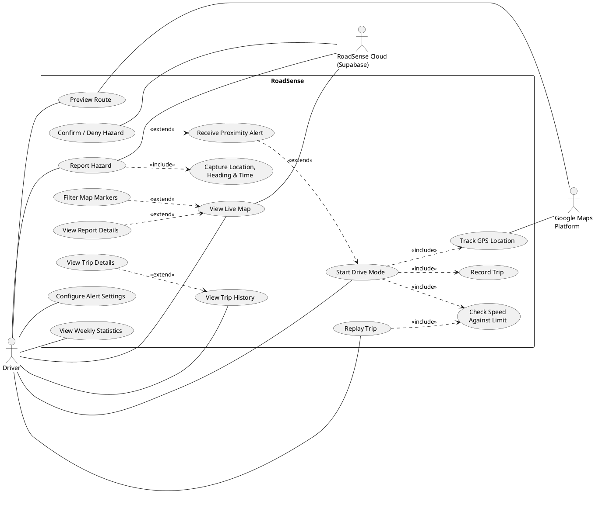
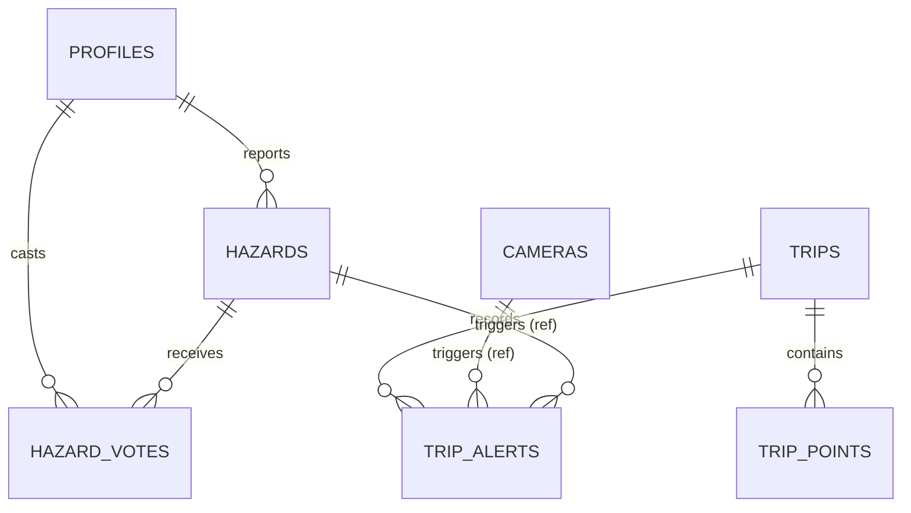
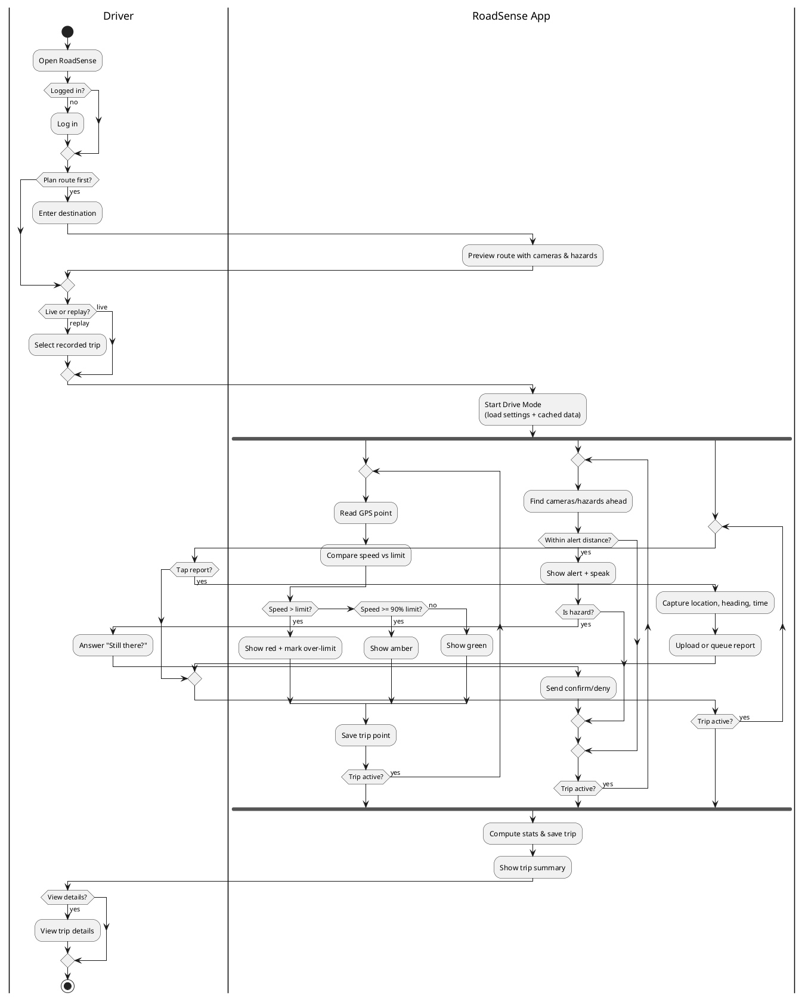

# RoadSense — Phase 1 Implementation Plan

**Module:** Mobile Development (25CSCI38H) · Coursework 01 — Phase 1
**Deadline:** Week 6 · **Weight:** 30 marks
**App:** RoadSense — React Native (Expo, TypeScript)
**Team:** Seif El-Deen Elattar (247563) · Mohamed Badawy (133424) · Yehia Mohamed (248678)

This plan covers every Phase 1 task (01–06), both deliverables, and the submission checklist. Each task lists **what to produce**, **how to produce it**, and **done when** criteria tied to the marking scheme.

> ⚠️ **AI rule:** AI may be used for code, but every significant interaction must be logged (see §10). **The report must be written by the team, not AI.** The tables, lists and diagram sources below are working notes for you to check, change and write up in your own words. Don't paste them into the report as they are.

---

## 0.1 Rules from the Course Website

Sources: CW-01 brief, Project brief, CW-02 brief, Labs 01–03, Setup, Tools/Git, Commands, Troubleshooting, Extra Learning on `labverse-indol.vercel.app/mobile-development`.

| Rule / finding | Source | Effect on this plan |
|---|---|---|
| Changes reach `main` only through a Pull Request. One branch per member. Never work on `main` directly. Example branch name: `ali/login-screen`. | Tools → Git, Lab 01 | §2.2 uses `<name>/<feature>` branches → PR → `main` |
| "Your commit history shows your individual contribution." Commit email must match your GitHub account. Use your real name. | Tools → Git, Lab 01 | §2.2 |
| Lab 02 convention: **one commit per finished page**. Commit messages in the imperative. | Lab 02, Commands | §2.2, §8.4 |
| Create projects with `npx create-expo-app@latest` then `npm run reset-project` (default template ships Expo Router). Use `npx expo install` for native libraries. | Lab 01, Commands | §2.1 |
| **Lab 03 architecture is feature-based:** `src/features/<name>/{screens,components,hooks,api.ts,types.ts}`, `src/components/ui`, `src/services`, `src/theme/tokens.ts`, `@/*` path alias. Features may import shared code. Shared code never imports a feature. Avoid giant top-level `components/`, `screens/` or `utils/`. | Lab 03 | §5.3 is now **feature-first MVVM**, which matches what the instructor taught |
| Typed routes, **no `as any`**. Expo Router: no `NavigationContainer`. Params come from `useLocalSearchParams()` as strings. | Lab 02, Lab 03 | §5.5, §8 |
| Folder structure must reflect the chosen pattern, e.g. MVVM or Provider/Context. **"Monolithic = 0 for Phase 2."** | Project brief | §5 |
| Consistent styling (StyleSheet **or** NativeWind). Clear loading, empty and error states. | Project brief | §8.0, §8.4 |
| No secrets in the repo: `.env` + `.gitignore`, commit `.env.example`. Never put a service-role key in the app. | Project brief, Lab 03 | §2.3 |
| Touch targets 44–48 pt, components under about 150 lines, `FlatList` + `keyExtractor` for lists | Extra Learning | §8.4 |
| AI log entry = **verbatim prompt → output → your changes & verification → rationale**. Prompts must state module, constraints and specifics. **AI code without its prompt in the log = 0 for the log and −5 from Phase 2.** Generating the whole app is heavily penalised. | Project brief, CW-02 | §10 (start the log now) |
| Report: no AI writing, **paraphrasing ≤ 20%** | Project brief FAQ | §9 |
| Phase 2 (50 marks): 3 unit tests (3 marks each), Google API, device feature, form validation, exception handling, and persistent storage marked **individually** (10 marks). The Phase 1 design must make these possible. | CW-02 | New §13 |
| Expo Go supports one SDK at a time. Campus Wi-Fi may block it, so use `--tunnel`. | Troubleshooting | §12 |
| "Your result" form on the Project page shows your group's **approved idea + feedback**. | Project brief | Check it before starting §3 |
| TAs: Ramy Abousaif, Ali Motawea, Youssef Mahmoud. Module leader: Dr. Amira Abdelaziz. | Overview | Ask them about the open questions in §12 |

---

## 0. Overview & Mark Map

| Task | What | Owner | Marks |
|---|---|---|---|
| 01 | System requirements (≥ 5 FRs, no login/sign-up) | Group | (part of the 5 marks not itemised) |
| 02 | Use case diagram | Group | 5 |
| 03 | Activity diagram | Group | 5 |
| 04 | 9 UI screens (3 per member) | **Individual** | 9 |
| 05 | Architecture / design pattern | Group | 6 |
| 06 | Data storage plan + data model diagram | Group | (part of the 5 marks not itemised) |

**Suggested order:**
1. Repo setup.
2. Requirements (01).
3. Architecture and folder structure (05).
4. Data model (06).
5. Use case diagram (02) and activity diagram (03), in parallel.
6. Screens (04).
7. Report.
8. Submission.

Diagrams and architecture come before screens because the screens have to follow the folder structure and use the entities.

---

## 1. Week-by-Week Schedule

| Step | Work | Who |
|---|---|---|
| **Step 1** | Create GitHub repo, Expo project, folder skeleton, shared theme/components, branches | Seif (setup) → all review |
| **Step 1** | Finalise FR1–FR7 + non-functional requirements | All |
| **Step 2** | Domain entities, repository interfaces, mock data, Zustand stores | All (split by feature, see §6.5) |
| **Step 2** | Use case diagram + activity diagram drafts | Mohamed (UC), Yehia (activity), Seif reviews |
| **Step 3** | Data model diagram + storage table | Yehia |
| **Step 3–4** | Each member implements their 3 screens on their own branch | Individual |
| **Step 4** | Pull requests into `main` (teammate reviews each PR), fix navigation, integrate | All |
| **Step 5** | Screenshots, write the report (by hand), contribution table | All |
| **Step 5** | Tag `phase-1` on `main`, final test on a real phone | All |
| **Step 6** | Print report, sign forms, upload to e-learning | All |

---

## 2. Repository & Git Setup

### 2.1 Create the project
Use the same commands as Lab 01. The default template already uses Expo Router and TypeScript.
```bash
npx create-expo-app@latest roadsense
cd roadsense
npm run reset-project            # answer Y; leaves a blank app/index.tsx
npx expo install react-native-maps expo-location expo-speech expo-sqlite @react-native-async-storage/async-storage
npm install zustand
npx expo install jest-expo jest @types/jest -- --save-dev   # Phase 2 needs 3 unit tests; set up now
npx expo-doctor                  # check for version mismatches
```
- Move `app/` to **`src/app/`**, which Expo Router supports, and add the `@/*` alias from Lab 03 to `tsconfig.json`:
  ```json
  { "extends": "expo/tsconfig.base",
    "compilerOptions": { "strict": true, "baseUrl": ".", "paths": { "@/*": ["src/*"] } } }
  ```
  Then run `npx expo start --clear`.
- **Styling:** pick one approach and use it everywhere. Either `StyleSheet` + `src/theme/tokens.ts`, or NativeWind (`npx expo install nativewind`, then follow its guide), as in Lab 03. Mixing them breaks the "consistent styling" rule.
- For Phase 1, `react-native-maps` with the default provider runs in **Expo Go**. Adding the Google Maps API key and making a development build can wait until Phase 2. Write this down in the report.
- Every member installs the **Expo Go version that matches the project's SDK**.

### 2.2 Branch strategy (required: each member commits on their own branch)
The course workflow is: own branch → push → Pull Request → `main`.
```
main                        ← only changes through PRs; tagged "phase-1" at submission
├── seif/setup              ← skeleton: folders, theme, ui components, navigation shell, mock data types
├── seif/drive-mode
├── mohamed/map-reports
└── yehia/trips-stats
```
- Seif opens the `seif/setup` PR first. After it's merged, everyone runs `git switch main && git pull`, then `git switch -c <name>/<feature>`.
- **Commit only from your own GitHub account.** Run `git config --global user.name "Real Name"` and `user.email "<the email on your GitHub account>"` once per laptop.
- Commit at least once per finished part of a screen, as in Lab 02's "one commit per page". Use imperative messages: `Add speed limit badge to Drive Mode`, `Fix filter chip state on Live Map`. Commit small and often, because individual marks look at your commits.
- Before every commit, run `git status` and check which branch you're on.
- Add every member as a collaborator. Protect `main` with "require a pull request", and have one teammate review each PR.
- Before a PR, run `git pull --rebase origin main` to keep conflicts small. Check `git log --oneline --graph --all` to see everyone's work.

### 2.3 Repo extras
- `README.md`: app description, how to run (`npx expo start`, or `--tunnel` on campus Wi-Fi), team, branch list. Include an **"Architecture decisions"** section, like the Lab 03 README.
- `.gitignore`: keep Expo's generated file and add `.env*` except `.env.example`. Never commit `node_modules`.
- `.env.example`: `EXPO_PUBLIC_APP_ENV=development`, `EXPO_PUBLIC_SUPABASE_URL=`, `EXPO_PUBLIC_SUPABASE_ANON_KEY=`, `EXPO_PUBLIC_GOOGLE_MAPS_KEY=`. Phase 1 doesn't need real keys. `EXPO_PUBLIC_` values are compiled into the app, so **never** put the Supabase `service_role` key there.
- Optional, from Lab 03: `app.config.ts` with development/staging/production variants and `eas.json`. This is good practice, but CW-01 doesn't require it.
- `docs/` folder: `product-brief.md` (problem, users, FRs, as in Lab 03), diagram source files (`.drawio` / `.puml`), exported PNGs, screenshots, `ai-log.md`.

---

## 3. Task 01 — System Requirements

### 3.1 Functional requirements (from the proposal: 7, which is more than the minimum of 5)

| ID | Requirement | Screen(s) | Use case(s) |
|---|---|---|---|
| FR1 | Drive Mode shows current GPS speed against the road speed limit; amber near the limit, red above it | Drive Mode | UC1 |
| FR2 | Spoken + on-screen alert when a speed camera or hazard is within the chosen distance in the direction of travel | Alert overlay, Alert settings | UC2, UC9 |
| FR3 | One-tap hazard report (accident, pothole, checkpoint, flooding); location, heading, time captured automatically | Drive Mode (report buttons) | UC3 |
| FR4 | "Still there?" prompt when passing a reported hazard; report expires after enough "no" answers or after a set time | Alert overlay, Report details | UC4 |
| FR5 | Route preview showing every camera and active hazard along a planned route | Route preview, Live map | UC5, UC6 |
| FR6 | Every drive saved with route, distance, duration, max/avg speed, over-limit segments, alerts received | Trip history, Trip details | UC7 |
| FR7 | Replay mode plays a recorded trip through the same logic for indoor testing/demo | Stats & replay | UC8 |

Login and sign-up exist but are **not** counted, so don't number them as FRs.

### 3.2 Make each FR measurable (put this in the report in your own words)
For each FR, write: **trigger → system response → acceptance condition**. Example for FR1:
- Amber when speed ≥ 90% of the limit. Red when speed > limit. Updates at least once a second.

Defaults to agree on:

| Parameter | Default |
|---|---|
| Amber threshold | ≥ 90% of limit |
| Alert distance options | 200 / 300 / 500 / 800 m (default 300 m) |
| "Direction of travel" cone | ±45° of heading |
| Hazard expiry | 3 "no" votes **or** 2 h (accident), 4 h (checkpoint), 24 h (flooding), 7 days (pothole) |
| GPS sample rate | 1 s |

### 3.3 Non-functional requirements (optional, but makes the report stronger)
- **Safety:** large touch targets (≥ 64 dp) in Drive Mode, and one tap per action.
- **Offline:** alerts still work without a connection, using cached cameras/hazards.
- **Performance:** speed reading updates at least once a second.
- **Privacy:** trip data stays on the device. Only hazard reports are shared.
- **Legal positioning:** uses a database of camera locations, not a radar detector. Presented as a road-safety tool.

**Done when:** the table has ≥ 5 FRs, none of them about login, and each FR maps to at least one use case and one screen.

---

## 4. Task 02 — Use Case Diagram (5 marks)

Marking: **1** actors · **1** correct logic · **3** mapping to requirements. **Wrong notation = 0**, so use proper UML.

### 4.1 Actors
| Actor | Type | Position |
|---|---|---|
| **Driver** | Primary | Left of system boundary |
| **Google Maps Platform** (Maps SDK, Roads API, Directions API) | Secondary (system) | Right |
| **RoadSense Cloud (Supabase)** | Secondary (system) | Right |
| **Timer** (optional, for report expiry) | Secondary | Right |

### 4.2 Use cases (inside a system boundary box labelled "RoadSense")
| UC | Name | FR |
|---|---|---|
| UC1 | Start Drive Mode | FR1 |
| UC1a | Track GPS Location | FR1, FR2, FR6 (included) |
| UC1b | Check Speed Against Limit | FR1 (included) |
| UC2 | Receive Proximity Alert | FR2 |
| UC3 | Report Hazard | FR3 |
| UC3a | Capture Location, Heading & Time | FR3 (included) |
| UC4 | Confirm / Deny Hazard ("Still there?") | FR4 |
| UC5 | Preview Route | FR5 |
| UC6 | View Live Map | FR5 |
| UC6a | Filter Map Markers | FR5 (extends) |
| UC6b | View Report Details | FR4 (extends) |
| UC7 | View Trip History | FR6 |
| UC7a | View Trip Details | FR6 (extends) |
| UC7c | Record Trip | FR6 (included by UC1) |
| UC8 | Replay Trip | FR7 |
| UC9 | Configure Alert Settings | FR2 |
| UC10 | View Weekly Statistics | FR6 |
| — | Log In | not counted; can be shown as an included precondition or left out |

### 4.3 Relationships (check the arrow directions)
- **«include»** (dashed arrow **from base → included**, the included step always runs):
  - Start Drive Mode → Track GPS Location
  - Start Drive Mode → Check Speed Against Limit
  - Start Drive Mode → Record Trip
  - Report Hazard → Capture Location, Heading & Time
  - Replay Trip → Check Speed Against Limit (same logic as live; FR7)
- **«extend»** (dashed arrow **from extension → base**, optional or conditional):
  - Receive Proximity Alert → Start Drive Mode *(condition: camera/hazard within alert distance and ahead)*
  - Confirm / Deny Hazard → Receive Proximity Alert *(condition: alert is a hazard)*
  - Filter Map Markers → View Live Map
  - View Report Details → View Live Map
  - View Trip Details → View Trip History
- **Associations** (solid lines, no arrowheads):
  - Driver ↔ UC1, UC3, UC5, UC6, UC7, UC8, UC9, UC10
  - Google Maps Platform ↔ View Live Map, Preview Route, Track GPS Location (Snap to Roads)
  - Supabase ↔ Report Hazard, Confirm/Deny Hazard, View Live Map

### 4.4 Notation checklist (to avoid getting 0)
- [ ] Stick-figure actors **outside** the boundary; use cases as **ovals inside** it
- [ ] Use case names are **verb + noun** ("Report Hazard", not "Hazard")
- [ ] «include» / «extend» are **dashed open arrows** with the stereotype label
- [ ] No arrows between actor and use case, and no flow or sequence shown (that belongs in the activity diagram)
- [ ] Every FR1–FR7 appears in at least one use case

### 4.5 Tool & reference source
Draw in **draw.io** (UML shape library) or **StarUML**. Save the source file in `docs/diagrams/`. A PlantUML draft to check against:



**Done when:** ≥ 1 primary actor, ≥ 5 use cases (we have 10+), include/extend used correctly, and a mapping table (FR → UC) next to the diagram in the report.

---

## 5. Task 05 — Architecture / Design Pattern (6 marks)

Marking: **2** selection · **2** applied in project structure · **2** reasoning.

### 5.1 Selection
**MVVM inside Clean Architecture** (domain / data / presentation), with **Zustand** for app state, as written in the proposal.

The **presentation layer is organised feature-first**, following Lab 03's feature-based architecture. Each feature folder holds its own screens (Views), ViewModel hooks and components. So the structure uses the vocabulary the module taught, and MVVM is still clearly visible. The project brief names MVVM as an accepted example, so the pattern choice itself is safe.

### 5.2 Reasoning (points to explain in your own words)
1. **Separation of concerns:** screens (Views) only render state and forward user actions. ViewModel hooks hold screen logic. Use cases hold business rules (e.g. "is this camera ahead and within 300 m?").
2. **Testability:** use cases are plain TypeScript with no React or device APIs, so they can be unit-tested with Jest. This matters for FR1/FR2 logic.
3. **Swappable data sources:** repositories are interfaces. Phase 1 uses **mock repositories**. Phase 2 swaps in Supabase/SQLite without touching any screen. This is the dependency inversion principle.
4. **Replay mode (FR7) depends on it:** the live GPS source and the replay source implement the same `LocationSource` interface, so the same use cases run both ways.
5. **Team split:** each member owns a feature slice (ViewModels, screens), which keeps merge conflicts low.
6. **Why not plain MVC / Context only?** React Native has no natural controller layer. Context re-renders the whole tree on high-frequency GPS updates, while Zustand selectors re-render only what changed.

Include a **layer diagram** in the report:
```
View (Screen .tsx)  →  ViewModel hook (useXViewModel)  →  Use case  →  Repository interface
                                ↑ Zustand store                         ↑ implemented by data layer
                                                                         (Mock → Supabase / SQLite / AsyncStorage)
```
Dependency rule: arrows point **inward**. `domain` imports nothing from `data` or `presentation`.

### 5.3 Folder structure (this is the "applied in project structure" mark)
```
roadsense/
├── src/
│   ├── app/                         # Expo Router routes: thin, each file only re-exports a feature screen
│   │   ├── _layout.tsx              # root <Stack/> (no NavigationContainer with Expo Router)
│   │   ├── (auth)/login.tsx         # extra, not counted
│   │   ├── (tabs)/_layout.tsx       # <Tabs/>: Drive | Map | Trips | Stats
│   │   ├── (tabs)/drive.tsx         # export { default } from '@/features/drive/screens/DriveModeScreen'
│   │   ├── (tabs)/map.tsx
│   │   ├── (tabs)/trips.tsx
│   │   ├── (tabs)/stats.tsx
│   │   ├── alert.tsx                # presentation: 'transparentModal'
│   │   ├── settings/alerts.tsx
│   │   ├── report/[id].tsx
│   │   ├── route-preview.tsx
│   │   └── trip/[id].tsx
│   │
│   ├── features/                    # PRESENTATION (View + ViewModel), one folder per feature/owner
│   │   ├── drive/                   # SEIF
│   │   │   ├── screens/             # DriveModeScreen, AlertOverlayScreen, AlertSettingsScreen  (Views)
│   │   │   ├── viewmodels/          # useDriveModeViewModel, useAlertOverlayViewModel, useAlertSettingsViewModel
│   │   │   └── components/          # SpeedGauge, LimitBadge, ReportButton, NextAlertCard
│   │   ├── map/                     # MOHAMED
│   │   │   ├── screens/             # LiveMapScreen, ReportDetailsScreen, RoutePreviewScreen
│   │   │   ├── viewmodels/
│   │   │   └── components/          # FilterChips, HazardMarker, CameraMarker, VoteBar
│   │   └── trips/                   # YEHIA
│   │       ├── screens/             # TripHistoryScreen, TripDetailsScreen, StatsReplayScreen
│   │       ├── viewmodels/
│   │       └── components/          # TripCard, SpeedColouredPolyline, WeeklyBarChart, ReplayControls
│   │
│   ├── domain/                      # MODEL: pure TypeScript, no React/Expo imports
│   │   ├── entities/                # Camera, Hazard, HazardVote, Trip, TripPoint, AlertEvent, Settings
│   │   ├── repositories/            # interfaces: CameraRepository, HazardRepository, TripRepository, SettingsRepository, LocationSource
│   │   └── usecases/
│   │       ├── drive/               # getSpeedStatus, findUpcomingAlerts, bearing/distance utils
│   │       ├── hazards/             # reportHazard, voteOnHazard, isHazardExpired
│   │       ├── routes/              # getAlertsAlongRoute
│   │       └── trips/               # listTrips, getTripDetails, getWeeklyStats
│   │
│   ├── data/                        # repository implementations
│   │   ├── mock/                    # Phase 1: JSON fixtures + Mock*Repository classes
│   │   ├── supabase/                # Phase 2 (empty stubs + README now)
│   │   ├── sqlite/                  # Phase 2
│   │   ├── storage/                 # AsyncStorage settings repo
│   │   └── di.ts                    # picks which implementation to use (single switch)
│   │
│   ├── components/ui/               # shared primitives, no business data: AppButton, Card, Chip, Badge, Screen, EmptyState, ErrorState
│   ├── stores/                      # Zustand: useSettingsStore, useDriveStore, useHazardStore, useTripStore
│   ├── services/                    # wrappers for device/3rd-party: location.ts, speech.ts, supabaseClient.ts (Phase 2)
│   ├── theme/tokens.ts              # colors, spacing, radius, typography
│   └── shared/                      # constants (thresholds), formatters (km/h, durations)
│
├── __tests__/                       # Jest tests for domain use cases
├── docs/                            # product-brief.md, diagrams/, screenshots/, ai-log.md
├── .env.example, app.json, tsconfig.json (@/* alias), package.json, README.md
```
Mapping for the report:
- **Model** = `domain/` + `data/`
- **ViewModel** = `features/*/viewmodels/` + `stores/`
- **View** = `features/*/screens/` + `components/`

Lab 03 rule: features import shared code (`components/ui`, `theme`, `domain`). Shared code **never** imports a feature. Features don't import each other.

### 5.4 Example of the pattern in code (put one short snippet in the report)
```ts
// domain/usecases/drive/getSpeedStatus.ts
export type SpeedStatus = 'ok' | 'near' | 'over';
export const getSpeedStatus = (speedKmh: number, limitKmh: number): SpeedStatus =>
  speedKmh > limitKmh ? 'over' : speedKmh >= limitKmh * 0.9 ? 'near' : 'ok';

// features/drive/viewmodels/useDriveModeViewModel.ts
export function useDriveModeViewModel() {
  const { speedKmh, limitKmh } = useDriveStore();
  const status = getSpeedStatus(speedKmh, limitKmh);
  return { speedKmh, limitKmh, status, onReport: (type: HazardType) => reportHazard(/* ... */) };
}

// features/drive/screens/DriveModeScreen.tsx: renders only
export default function DriveModeScreen() {
  const vm = useDriveModeViewModel();
  return <SpeedGauge speed={vm.speedKmh} status={vm.status} />;
}
```

### 5.5 Rules to enforce in PR review
- No `fetch`, `supabase`, `expo-location`, `expo-speech` or `expo-sqlite` imports inside `features/`. Device and SDK code lives in `services/` or `data/`.
- No React imports inside `domain/`.
- Screens never import from `data/`. They go through a ViewModel, then a use case, then a repo obtained from `di.ts`.
- `components/ui` never imports from `features/`, and features never import each other.
- All routes and params are typed (Lab 03). **No `as any`.** `useLocalSearchParams<{ id: string }>()`, and remember params arrive as strings.
- Keep components under about 150 lines (Extra Learning). Split anything larger into `components/`.
- Use `@/` imports across folders and relative imports inside one feature.
- Add one Jest test per member for a use case (e.g. `getSpeedStatus`, `isHazardExpired`, `getWeeklyStats`). This backs up the "testability" argument.

**Done when:** the pattern is named, the folder tree matches it, the reasoning has at least 4 justified points, and a layer diagram and snippet are in the report.

---

## 6. Task 06 — Data Storage Plan

### 6.1 Where each item lives
| Store | Technology | Holds | Why |
|---|---|---|---|
| Cloud | **Supabase (PostgreSQL)** | users/profiles, cameras, hazards, hazard votes | Shared between all drivers in real time (Realtime subscriptions) |
| Local DB | **SQLite (expo-sqlite)** | trips, trip points, trip alerts, cached cameras & hazards, pending (unsent) reports | Large/private/offline data; alerts must work with no signal |
| Key-value | **AsyncStorage** | user settings (alert distance, enabled types, voice on/off, units) | Small, simple, loaded at start-up |
| Memory | **Zustand** | current speed, current trip, active alert, map filters | Live UI state, not persisted |
| Phase 1 | `data/mock/*.json` | same shapes as above | Screens work now; real stores come in Phase 2 |

### 6.2 Data items and types
**Cloud: Supabase**

| Table | Field | Type |
|---|---|---|
| `profiles` | id | uuid (PK, = auth user id) |
| | display_name | text |
| | created_at | timestamptz |
| `cameras` | id | uuid PK |
| | lat, lng | double precision |
| | heading | int (0–359, direction it faces; null = both) |
| | speed_limit_kmh | int |
| | road_name | text |
| | type | enum('fixed','average','red_light') |
| `hazards` | id | uuid PK |
| | type | enum('accident','pothole','checkpoint','flooding') |
| | lat, lng | double precision |
| | heading | int |
| | reported_by | uuid FK → profiles |
| | created_at | timestamptz |
| | expires_at | timestamptz |
| | confirmations, denials | int |
| | status | enum('active','expired') |
| `hazard_votes` | id | uuid PK |
| | hazard_id | uuid FK → hazards |
| | user_id | uuid FK → profiles |
| | still_there | boolean |
| | voted_at | timestamptz |
| | UNIQUE(hazard_id, user_id) | |
| `speed_limits` (Cairo table) | id, road_name, geometry/segment, limit_kmh | uuid, text, text (encoded polyline), int |

**Local: SQLite**

| Table | Field | Type |
|---|---|---|
| `trips` | id | TEXT (uuid) PK |
| | started_at, ended_at | INTEGER (epoch ms) |
| | distance_m | REAL |
| | duration_s | INTEGER |
| | max_speed_kmh, avg_speed_kmh | REAL |
| | over_limit_count | INTEGER |
| | encoded_polyline | TEXT |
| `trip_points` | id | INTEGER PK AUTOINCREMENT |
| | trip_id | TEXT FK → trips |
| | ts | INTEGER |
| | lat, lng, speed_kmh, heading | REAL |
| | limit_kmh | INTEGER |
| `trip_alerts` | id | INTEGER PK |
| | trip_id | TEXT FK |
| | ts | INTEGER |
| | kind | TEXT ('camera'/'hazard') |
| | ref_id | TEXT |
| | distance_m | REAL |
| `cached_cameras`, `cached_hazards` | same columns as cloud + `cached_at` INTEGER | |
| `pending_reports` | local_id PK, type, lat, lng, heading, created_at, retry_count | TEXT/REAL/INTEGER |

**AsyncStorage**: key `roadsense.settings`, holding a JSON `Settings` object:
```ts
{ alertDistanceM: 300, enabledTypes: ['camera','accident','pothole','checkpoint','flooding'],
  voiceEnabled: true, soundEnabled: true, units: 'kmh', amberThresholdPct: 90 }
```

### 6.3 Preliminary data model diagram (ERD)
Draw it properly in draw.io for the report, showing PK/FK and cardinalities. Mermaid draft:

Split the diagram into two boxes: **Cloud (Supabase)** and **Device (SQLite + AsyncStorage)**. Show `cached_*` as copies synced from the cloud and `pending_reports` as an upload queue.

### 6.4 Domain entities (`src/domain/entities/`)
```ts
export type HazardType = 'accident' | 'pothole' | 'checkpoint' | 'flooding';
export interface LatLng { lat: number; lng: number }
export interface Camera extends LatLng { id: string; heading: number | null; speedLimitKmh: number; roadName: string; type: 'fixed' | 'average' | 'red_light' }
export interface Hazard extends LatLng { id: string; type: HazardType; heading: number; reportedBy: string; createdAt: string; expiresAt: string; confirmations: number; denials: number; status: 'active' | 'expired' }
export interface TripPoint extends LatLng { ts: number; speedKmh: number; heading: number; limitKmh: number }
export interface AlertEvent { ts: number; kind: 'camera' | 'hazard'; refId: string; distanceM: number }
export interface Trip { id: string; startedAt: number; endedAt: number; distanceM: number; durationS: number; maxSpeedKmh: number; avgSpeedKmh: number; overLimitCount: number; points: TripPoint[]; alerts: AlertEvent[] }
export interface Settings { alertDistanceM: number; enabledTypes: (HazardType | 'camera')[]; voiceEnabled: boolean; soundEnabled: boolean; units: 'kmh'; amberThresholdPct: number }
```

### 6.5 Mock data (shared types on `seif/setup`; each owner fills their fixture on their own branch)
`src/data/mock/`:
- `cameras.json`: about 10 Cairo cameras (Ring Road, 26th of July Corridor, Salah Salem, Autostrad, New Cairo 90th St). Centre the map near 30.0444, 31.2357.
- `hazards.json`: about 8 hazards covering all 4 types, a mix of ages and votes, plus one expired.
- `trips.json`: 5–6 trips over the last 2 weeks, each with 50–200 points and some over-limit stretches. One of these is the **replay demo trip**.
- `MockCameraRepository`, `MockHazardRepository`, `MockTripRepository`, `MockSettingsRepository` implement the domain interfaces and return `Promise`s with a short artificial delay, so loading states show.

Ownership: Seif writes cameras plus the settings repo, Mohamed writes hazards, and Yehia writes trips.

**Done when:** a storage table (item → type → local/cloud → reason) and an ERD are in the report.

---

## 7. Task 03 — Activity Diagram (5 marks)

Marking: **2.5** covers the requirements · **2.5** correct flow. **−0.5 per missing or incorrect component.**

### 7.1 Scope
One main diagram, **"Drive with RoadSense"**, covering FR1–FR6, with replay (FR7) as a branch at the start. Using swimlanes (**Driver | RoadSense App | Cloud/Google**) is recommended. The diagram must match the use case names.

### 7.2 Flow (draw these nodes in this order)
1. **● Start**
2. Open app → [decision: logged in?] → *no* → Log in → merge
3. [decision: "Plan route first?"]
   - *yes* → Enter destination → **Preview route** (fetch Directions, list cameras/hazards along it) *(FR5)* → merge
   - *no* → merge
4. [decision: "Live drive or replay?"] → *replay* → Select recorded trip → feed recorded points *(FR7)* → join the same loop below
5. **Start Drive Mode**. Load settings and cached cameras/hazards.
6. **Fork (parallel bar)** into:
   - **A: Speed monitoring loop** *(FR1)*: Read GPS point → Snap to road / get limit → Compare speed vs limit → [decision] ok → green / near → amber / over → red + mark over-limit segment → Save trip point *(FR6)*
   - **B: Alert loop** *(FR2, FR4)*: Find cameras/hazards ahead within alert distance → [decision: any?] → *yes* → Show alert card + speak alert → [decision: is hazard?] → *yes* → Ask "Still there?" → [decision answer] → Send confirm/deny → [decision: denials ≥ 3 or expired?] → *yes* → Mark hazard expired
   - **C: Reporting** *(FR3)*: [decision: driver taps report?] → *yes* → Capture location, heading, time → [decision: online?] → *yes* → Upload report / *no* → Queue in pending reports
7. Each loop returns to its start while [trip active]. Show the loop as a decision diamond with a back-edge.
8. Driver taps **End trip** → **Join (parallel bar)**
9. Compute distance, duration, max/avg speed, over-limit count → **Save trip** *(FR6)*
10. Show trip summary → [decision: view details?] → *yes* → **View trip details** (coloured route, alerts marked)
11. **◉ End**

### 7.3 Notation checklist
- [ ] Exactly one filled **start** node and at least one **end** node (bullseye)
- [ ] Activities are **rounded rectangles** with verb phrases
- [ ] Every **decision diamond** has labelled guards `[yes]`/`[no]`, and branches meet again at a **merge diamond**
- [ ] **Fork/join bars** for parallel loops. Every fork has a matching join.
- [ ] No dangling arrows. Every path reaches End.
- [ ] Activity names match the use case names (e.g. "Report Hazard", "Preview Route")

### 7.4 PlantUML draft (for checking; draw the final version yourselves)


**Done when:** every FR1–FR7 has at least one activity, the flow is valid UML, and the names match the use case diagram.

---

## 8. Task 04 — UI Screens (9 marks, individual)

Marking: **1 per screen**. Missing screen −1, incorrect screen −0.5. Each screen must **run, be reachable through navigation, show realistic mock data, and handle its interactions**. Login, sign-up, forgot password and splash are extras and are not counted.

### 8.0 Shared foundation (Seif sets up on `seif/setup` in Step 1, everyone reviews the PR)
- **Theme (`src/theme/tokens.ts`, same shape as Lab 03):** dark-first for driving.
  - `colors.background = #0B1020`, `surface = #151C31`, `text = #F8FAFC`, `muted = #94A3B8`
  - `ok = #22C55E`, `near = #F59E0B`, `over = #EF4444`, `camera = #3B82F6`, plus hazard colours per type
  - `spacing { xs:4, sm:8, md:16, lg:24, xl:32 }`, `radius { sm:8, md:14, pill:999 }`
- **Shared primitives (`src/components/ui`):** `Screen` (safe-area wrapper), `AppButton` (with a `variant` prop rather than several booleans, per Lab 03), `Card`, `Chip`, `Badge`, `EmptyState`, `ErrorState`, `LoadingState`, `SectionHeader`. Primitives own their look, pressed and disabled states and accessibility labels. Features decide what happens on press.
- **Navigation:** bottom tabs **Drive · Map · Trips · Stats**. Stack screens: Alert Settings, Report Details, Route Preview, Trip Details. Modal: Alert Overlay.
- **Stores:** `useSettingsStore` (persisted with zustand `persist` + AsyncStorage), `useDriveStore` (speed, limit, heading, activeAlert, isDriving), `useHazardStore` (hazards, filters), `useTripStore` (trips, selectedTrip, replay state).
- **Fake GPS for Phase 1:** a `MockLocationSource` that plays points from a mock trip once a second. Drive Mode, Alert overlay and Replay all use it. This doubles as the FR7 foundation.

### 8.1 Seif El-Deen Elattar: branch `seif/drive-mode`

#### Screen 1 — Drive Mode (`(tabs)/drive.tsx`) · FR1, FR3
- **UI:**
  - Large circular speed gauge with the current km/h in the centre.
  - Ring colour follows `ok/near/over`.
  - Round red-bordered **speed limit badge** (road sign style).
  - "Next alert" card, e.g. "📷 Camera · 450 m · Ring Road".
  - Row of 4 large **report buttons** (Accident, Pothole, Checkpoint, Flooding).
  - Start/Stop trip button. Settings gear in the header.
- **State (ViewModel):** `speedKmh`, `limitKmh`, `status`, `nextAlert`, `isDriving`, `onStart()`, `onStop()`, `onReport(type)`.
- **Behaviour:**
  - Start plays `MockLocationSource`, so the speed changes over time.
  - Tapping report shows a toast like "Pothole reported at 14:32" and adds the report to `useHazardStore`.
  - When `nextAlert.distance ≤ alertDistance`, navigate to the Alert overlay.
- **Done when:** the colour visibly changes green → amber → red during the mock drive, report buttons give feedback, and the gear opens Alert Settings.

#### Screen 2 — Alert Overlay (`alert.tsx`, transparent modal) · FR2, FR4
- **UI:**
  - Large card over a dimmed Drive Mode.
  - Icon by type (camera/accident/...), title "Speed camera ahead", distance counting down, limit for cameras, road name.
  - For hazards, a **"Still there?"** section with large **Yes** / **No** buttons and a "reported 25 min ago · 4 confirmations" line.
  - Dismiss (×).
  - Speaks the alert with `expo-speech` ("Speed camera in 300 metres") when voice is enabled in settings.
- **State:** `alert`, `distanceM`, `isHazard`, `onVote(stillThere)`, `onDismiss()`.
- **Behaviour:**
  - A vote updates `confirmations`/`denials` in the store.
  - When denials reach the threshold, status becomes `expired` (`isHazardExpired` use case).
  - Auto-dismiss after the point is passed, or after 8 s.
- **Done when:** the camera and hazard variants both render, voting changes the counts (visible later in Report Details), and voice obeys the setting.

#### Screen 3 — Alert Settings (`settings/alerts.tsx`) · FR2
- **UI:**
  - Segmented control for alert distance (200/300/500/800 m).
  - Toggle list for alert types (Speed cameras, Accidents, Potholes, Checkpoints, Flooding), each with an icon.
  - Voice alerts toggle and sound alerts toggle.
  - "Test voice" button. Amber threshold slider or segmented control (85/90/95%).
  - Reset to defaults.
- **State:** bound to `useSettingsStore`, which persists to AsyncStorage.
- **Done when:** settings survive an app reload, disabled types stop appearing in alerts, and "Test voice" speaks.

### 8.2 Mohamed Badawy: branch `mohamed/map-reports`

#### Screen 4 — Live Map (`(tabs)/map.tsx`) · FR5
- **UI:**
  - Full-screen `MapView` centred on the user (mock location), with a user marker and heading arrow.
  - **Camera markers** in blue. **Hazard markers** with a colour and icon per type.
  - Horizontal **filter chips** at the top: All, Cameras, Accidents, Potholes, Checkpoints, Flooding.
  - Re-centre button and legend.
  - A "Plan route" floating button opens Route Preview.
- **State:** `cameras`, `hazards` (active only), `filters`, `toggleFilter()`, `onMarkerPress(id)`.
- **Behaviour:** filters hide/show markers. Pressing a hazard marker opens a callout, then Report Details.
- **Done when:** the markers from the mock data appear in Cairo, the filters work, and tapping a marker navigates.

#### Screen 5 — Report Details (`report/[id].tsx`) · FR4
- **UI:**
  - Small map snapshot at the top with the hazard pin.
  - Type badge, address/road, "Reported 25 min ago", "Expires in 1 h 35 min".
  - **Vote bar** showing confirmations vs denials (e.g. 4 ✔ / 1 ✘).
  - Status chip (Active/Expired).
  - "Still there?" Yes/No buttons, and a timeline of recent votes.
- **State:** `hazard`, `timeAgo`, `expiresIn`, `onVote()`, `isExpired`.
- **Done when:** it opens from a map marker with the right hazard, votes update the bar, and expired hazards show the expired state with voting disabled.

#### Screen 6 — Route Preview (`route-preview.tsx`) · FR5
- **UI:**
  - From/To inputs (From = "Current location"). Destination suggestion list from mock places (e.g. "BUE, El Shorouk", "Cairo Festival City", "Tahrir Square").
  - Map with the **route polyline** and the cameras/hazards along it.
  - Summary card: "18.4 km · 27 min · 3 cameras · 2 hazards".
  - Scrollable list of alerts in order along the route (km marker, type, limit).
  - "Start drive" button goes to Drive Mode.
- **State:** `destination`, `route` (mock polyline JSON for Phase 1, Directions API in Phase 2), `alongRoute` (from the `getAlertsAlongRoute` use case: within 50 m of the polyline), `onStart()`.
- **Done when:** picking a destination draws a route and lists the right markers, and Start leads to Drive Mode.

### 8.3 Yehia Mohamed: branch `yehia/trips-stats`

#### Screen 7 — Trip History (`(tabs)/trips.tsx`) · FR6
- **UI:**
  - List grouped by day ("Today", "Yesterday", "Mon 19 Oct").
  - Each **TripCard** shows the start → end time, distance, duration, max speed, and an **over-limit count badge** (red if > 0). Small route thumbnail is optional.
  - Pull-to-refresh, empty state, and a sort/filter option (All / With over-limit).
- **State:** `trips`, `grouped`, `filter`, `onSelect(id)`.
- **Done when:** the mock trips list correctly, the filter works, and tapping opens Trip Details.

#### Screen 8 — Trip Details (`trip/[id].tsx`) · FR6
- **UI:**
  - Map with the **route coloured by speed vs limit**: one polyline segment per point pair, coloured green/amber/red with `getSpeedStatus`.
  - Alert markers where alerts were received.
  - Stats grid: distance, duration, max speed, avg speed, over-limit segments, alerts.
  - Timeline list of alerts and over-limit stretches ("14:05 · 92 km/h in 80 zone · Salah Salem").
  - "Replay this trip" button goes to Stats & Replay with the trip preselected.
- **State:** `trip`, `segments`, `stats`, `events`, `onReplay()`.
- **Done when:** the colours are correct on the over-limit stretches of the mock trip and the stats match the data.

#### Screen 9 — Stats & Replay (`(tabs)/stats.tsx`) · FR6, FR7
- **UI, top: Weekly stats**
  - Week selector (‹ This week ›).
  - Bar chart of km per day. Build it from simple `View` bars, or use `react-native-svg`.
  - Tiles: total km, drive time, average speed, over-limit count, alerts received.
  - "% of time within limit" indicator.
- **UI, bottom: Replay control**
  - Trip picker.
  - Play/Pause, speed ×1/×2/×4, and a scrubber/progress bar.
  - Mini speed readout and status colour.
  - "Open in Drive Mode" toggle, so replay feeds `MockLocationSource` and Drive Mode and alerts react. This is the FR7 demo.
- **State:** `weekStats` (from the `getWeeklyStats` use case), `replay: { tripId, isPlaying, rate, index }`, `play()`, `pause()`, `seek()`.
- **Done when:** the stats compute from mock trips, replay advances through the points, and Drive Mode reacts when linked.

### 8.4 Per-screen quality checklist (each member, before the PR)
- [ ] Reachable through navigation, with no dead ends and a working back navigation
- [ ] Uses the ViewModel hook. No data imports in the screen file.
- [ ] Loading, empty and error states handled. The project brief requires "clear feedback". Mock repos have a short delay plus a way to force an error so you can show all three.
- [ ] Inputs (destination search, settings) already show inline validation messages. Phase 2 marks form validation.
- [ ] Realistic Cairo mock data (no "Lorem ipsum")
- [ ] Touch targets ≥ 48 pt (≥ 64 in Drive Mode), visible pressed states, safe areas respected
- [ ] Lists use `FlatList` + `keyExtractor` on ids, not indexes
- [ ] Routes and params are typed, with no `as any`. Components are under about 150 lines.
- [ ] Looks right on a small phone (≈ 360 dp wide) and a large one. No overflow.
- [ ] No TypeScript errors (`npx tsc --noEmit`) or red-box warnings
- [ ] Tested on a real phone in Expo Go
- [ ] Screenshot saved to `docs/screenshots/<member>/<screen>.png` for the report
- [ ] At least one commit per screen part, all from this member's own account and branch
- [ ] Every AI-generated piece of code has its entry in `docs/ai-log.md` **in the same commit**
- [ ] The member can explain every line. The viva and demo ask individual questions.

### 8.5 Extras (not counted, but needed for a complete app)
Splash, Login and Sign-up as UI only, with a "Continue" button that goes to tabs (fake auth for Phase 1). Seif or anyone with spare time can build these on `<name>/auth-ui`. Login/sign-up forms are a natural place for **form validation** (email format, password length, matching passwords), which Phase 2 marks.

---

## 9. Deliverable 1 — Report Outline

Written by the team in your own words. **No AI-written text, and paraphrasing is limited to 20%** (Project brief FAQ). Phase 2 needs an *amended* version of this report, so keep the source file editable (Word or Google Docs).

1. **Page 1:** cover info + **Contribution table**:

   | Member | ID | Screens | Group tasks | Branch | % |
   |---|---|---|---|---|---|
   | Seif El-Deen Elattar | 247563 | Drive Mode, Alert Overlay, Alert Settings | Repo setup, architecture section | seif/setup, seif/drive-mode | 33.3 |
   | Mohamed Badawy | 133424 | Live Map, Report Details, Route Preview | Use case diagram | mohamed/map-reports | 33.3 |
   | Yehia Mohamed | 248678 | Trip History, Trip Details, Stats & Replay | Activity diagram, data model | yehia/trips-stats | 33.3 |

2. Introduction: RoadSense, the problem, target users (Cairo commuters, delivery riders, ride-hailing drivers)
3. System requirements: FR table + NFRs (Task 01)
4. Use case diagram + FR→UC mapping table + short description of each include/extend (Task 02)
5. Activity diagram + explanation of the parallel loops (Task 03)
6. Architecture: chosen pattern, reasoning, layer diagram, folder tree screenshot, code snippet (Task 05)
7. Data storage plan: storage table, data types, ERD, offline sync strategy (Task 06)
8. UI implementation: for each member, 3 screenshots + a short description + FR covered (Task 04)
9. GitHub repo link + branch list + commit graph screenshot
10. Phase 2 outlook: Supabase, SQLite, Google APIs, real GPS
11. Appendix: AI usage log

---

## 10. AI Engineering Log (`docs/ai-log.md`): start it now

Phase 2 gives the log **15 marks**: 5 completeness, 3 prompt quality, 4 critical analysis, 3 rationale. **AI code without its prompt in the log = 0 for the log and −5 from Phase 2 implementation.** Writing entries afterwards is how they get missed, so log each one when you use AI.

**Rules (Project brief, CW-02):**
- Use AI for **specific, well-described parts**, never "generate the whole app". Design the modules yourselves, which is what this plan's structure is for.
- Write your **own** prompts, naming the **module, constraints and specifics**. Generic or copy-pasted prompts score low.
  - ✘ "make a map screen"
  - ✔ "RoadSense, `features/map`, Expo Router + react-native-maps, TypeScript strict. Write `LiveMapScreen` that only renders state from `useLiveMapViewModel()` (fields: cameras, hazards, filters, toggleFilter). Use tokens from `@/theme/tokens`. No data imports."

**Entry template (one per significant interaction):**
```markdown
### AI-007 · 2026-10-30 · Mohamed · features/map · Claude Code
**Prompt (verbatim):**
> ...
**Output:** (full code produced, or a link to the commit/diff)
**My changes & verification:** what I changed and why; how I tested it (ran on phone, tsc, jest)
**Rationale:** why AI was appropriate for this part
```

First entry: **this plan.** Log the prompt that produced `phase-1-plan.md` and this website review, credited to the member who ran it.

---

## 11. Submission Checklist

- [ ] All member branches merged into `main` through PRs, tagged `phase-1`
- [ ] App runs from a fresh clone: `npm install && npx expo start`. `npx expo-doctor` is clean.
- [ ] No secrets in the repo; only `.env.example` is committed
- [ ] All 9 screens tested on a real phone (Expo Go)
- [ ] ≥ 5 FRs, none of them about login. Use case diagram (≥ 1 actor, ≥ 5 UCs). Activity diagram. Architecture. Data plan with ERD.
- [ ] Contribution table on **page 1**
- [ ] Report written by the team, AI log in the appendix
- [ ] Report PDF + repo link (or zipped code) uploaded to **e-learning** before the Week 6 deadline
- [ ] **Printed copy** handed in
- [ ] Signed **Coursework submission form** + **Statement of Academic Honesty**

---

## 12. Risks & Mitigations

| Risk | Mitigation |
|---|---|
| Google Maps on Android needs an API key / dev build | Phase 1 uses the default provider in Expo Go. Add the key in Phase 2. |
| "Alert overlay" judged as not a real screen | Make it its own route (`alert.tsx`) presented as a modal with its own ViewModel, and also reachable from a "Preview alert" button in Alert Settings |
| "Stats and replay" judged as two half-screens | Keep both in one route with a clear title. Both features are fully interactive. |
| Merge conflicts in shared files (`_layout.tsx`, stores) | Seif creates all route files as placeholders in `seif/setup`, so members only fill their own `features/<name>/` folders |
| Commits not credited | Check `git config user.email` per member, and never commit for another member |
| Real GPS hard to demo indoors | `MockLocationSource` + replay (FR7) from day one |
| Expo Go "incompatible SDK" error | Everyone installs the Expo Go version for the project's SDK. Run `npx expo install --fix` and don't upgrade the SDK mid-phase. |
| Campus Wi-Fi blocks Expo Go | `npx expo start --tunnel`, or the Android emulator (`a`) |
| Mixing npm and yarn breaks installs | npm only, with one committed `package-lock.json` |
| Open questions about screen counting (overlay/modal, combined Stats & Replay) | Ask a TA or Dr. Amira **before Week 6**, and check the "Your result" feedback on the Project page |

---

## 13. Phase 2 Readiness (decide now so Phase 1 doesn't block it)

CW-02 (Week 12, 50 marks) builds on this phase. Persistent data (10 marks) and the APIs/validation marks (11) are **individual**, so every member needs their own piece.

| CW-02 requirement | RoadSense choice | Phase 1 prep | Owner |
|---|---|---|---|
| Architecture implemented (5); monolithic = 0 for the whole phase | MVVM + Clean, feature-first | §5 structure + PR rules | All |
| Persistent storage (10, individual: 5 implemented + 5 running) | AsyncStorage settings + SQLite `pending_reports` queue | `SettingsRepository` interface, settings store | Seif |
| | Supabase `hazards`, `hazard_votes`, `cameras` (+ realtime) | `HazardRepository` / `CameraRepository` interfaces | Mohamed |
| | SQLite `trips`, `trip_points`, `trip_alerts` | `TripRepository` interface | Yehia |
| Google API (2.5) | **Google Maps Platform**: Maps SDK (map), Directions (route preview), Roads (snap to road) | Map screens built on `react-native-maps`. Keys go in `.env`, restricted by app package. | Mohamed (+ all screens with maps) |
| Device feature (2.5) | **Location** (`expo-location`) for speed and heading. Also speech (`expo-speech`) and optionally the accelerometer. | `LocationSource` interface; `MockLocationSource` now, real one later | Seif |
| Form validation (3) | Login/sign-up, destination search, alert settings, hazard report confirmation | Inline error UI already in Phase 1 screens | Each member on their screens |
| Exception handling (3) | Network/GPS-permission/DB errors → friendly `ErrorState` + retry | `ErrorState` primitive, repos return typed errors | Each member |
| 3 unit tests (9, 3 per passing test) | 1. `getSpeedStatus` (ok/near/over boundaries)<br>2. `isHazardExpired` (votes + time)<br>3. `getWeeklyStats` (or `findUpcomingAlerts` direction cone) | Jest set up in §2.1; write the use cases as pure functions | Seif / Mohamed / Yehia |
| AI engineering log (15) | `docs/ai-log.md` | Started in Phase 1 (§10) | All |
| Demo (20, individual questions) | Replay a Cairo drive: speed turns red, "speed camera in 300 metres", a hazard from a 2nd phone appears | Replay mode (FR7) and mock data from Phase 1 | All |
